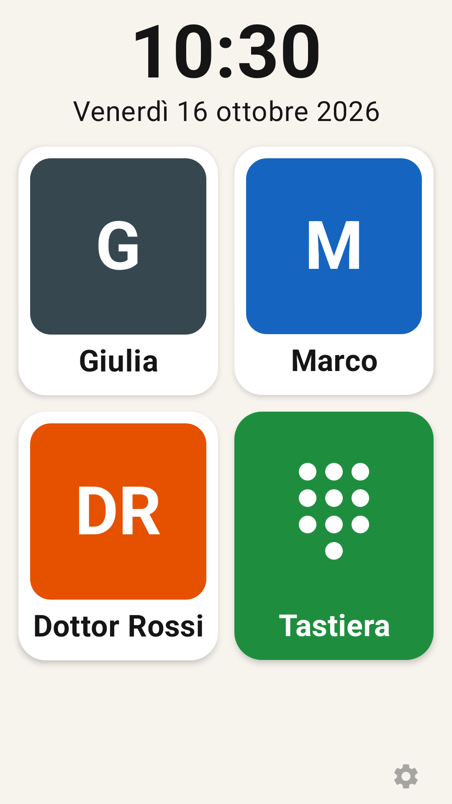
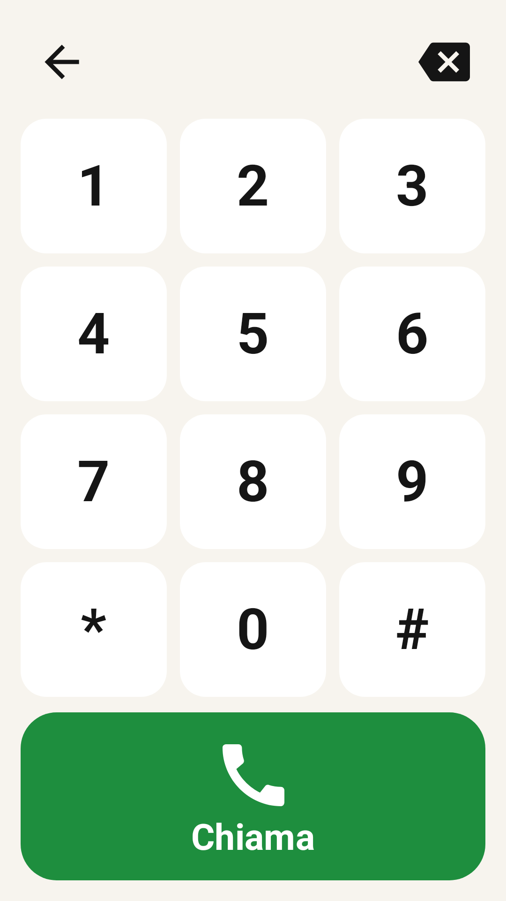
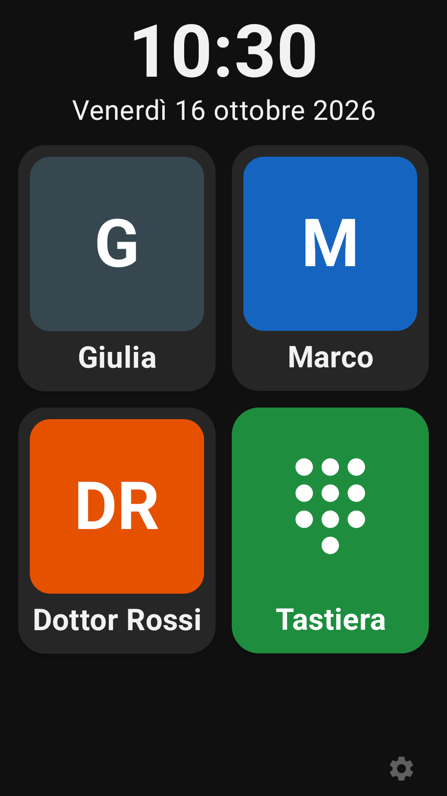

# Telefono Semplice

[](https://buymeacoffee.com/faxioman)

App Android pensata per persone anziane con demenza: **sostituisce sia la schermata Home sia l'app Telefono** del dispositivo.

## Schermate

<p>    </p>

<p></p>

## Funzioni

| Funzione | Come è fatta |
|---|---|
| Launcher | `MainActivity` risponde a `CATEGORY_HOME`: orologio grande con data, griglia di contatti con foto, il tasto Indietro non fa nulla |
| Contatti con foto e chiamata immediata | Un tocco sulla foto avvia subito la chiamata (`TelecomManager.placeCall`). I doppi tocchi entro 4 s vengono ignorati. Si aggiungono dalla rubrica, con la foto del contatto in alta risoluzione, oppure a mano. La foto si sposta e si ingrandisce con le dita in un ritaglio quadrato |
| Sempre vivavoce | La chiamata parte con `EXTRA_START_CALL_WITH_SPEAKERPHONE`, poi `PhoneInCallService` rimette l'audio sull'altoparlante a ogni cambio di instradamento |
| Lista nera / lista bianca | `ScreeningService` (`CallScreeningService`) rifiuta la chiamata prima che squilli. Il controllo viene ripetuto in `PhoneInCallService` come rete di sicurezza. Modalità: accetta tutte · blocca lista nera · solo contatti + lista bianca. Opzione per bloccare i numeri privati. I numeri delle liste si possono prendere dalla rubrica |
| Tastierone | `KeypadActivity`, disattivabile dalle preferenze. Gestisce anche `ACTION_DIAL` (requisito per essere app Telefono predefinita) |
| Preferenze protette | Ingranaggio semitrasparente in basso a destra. PIN da 4–8 cifre (all'inizio nessun PIN: va impostato) |
| Chiamata in arrivo | Foto a tutto schermo, nome grande, bottoni **Butta giù** / **Rispondi**; si risponde anche toccando la foto. Funziona anche a schermo bloccato grazie a una notifica full-screen `CallStyle` |
| Schermo | Opzioni "non andare mai in standby" e luminosità dell'app (fissa o di sistema). La barra di navigazione di Android è sempre nascosta |
| Tasto di accensione | Opzione "ignora il tasto di accensione": il tasto non si può intercettare, quindi lo schermo viene riacceso subito sulla Home. La pressione lunga spegne ancora il telefono |
| Verticale e orizzontale | In orizzontale la chiamata mostra la foto a sinistra e i bottoni a destra; nella Home il numero di colonne si adatta per avere le foto più grandi possibili senza scorrere |
| Tema | Chiaro o scuro, dalle impostazioni (sezione *Aspetto*). Verde e rosso dei bottoni restano uguali nei due temi |
| Lingue | it, en, es, fr, de, pt, ru, ar, hi, zh. Si sceglie dalle preferenze, oppure segue la lingua del sistema |
| Chiamate perse | Elenco nelle impostazioni (perse, buttate giù, bloccate, occupato) con tasto "Richiama". Lo tiene l'app, quindi non servono permessi |
| SMS | Nelle impostazioni c'è un tasto per aprire l'app Messaggi ufficiale. Concedendo il permesso SMS, gli ultimi messaggi compaiono anche lì; toccandone uno si apre la conversazione |
| Risposta automatica | Facoltativa, dopo 5, 10, 20 o 30 secondi di squillo, di default solo per i contatti. La schermata mostra il conto alla rovescia |
| Seconda chiamata = occupato | Se è già al telefono, la nuova chiamata viene rifiutata e finisce nell'elenco. C'è anche un tasto per disattivare l'avviso di chiamata presso l'operatore (`#43#`), così l'occupato lo dà direttamente la rete |
| È lei il telefono | Implementa `InCallService` con UI propria e chiede il ruolo `ROLE_DIALER` |

## Primo avvio sul telefono (lo fa il familiare)

1. Installare l'APK (serve abilitare "origini sconosciute").
2. Aprire l'app e concedere i permessi per chiamate e notifiche.
3. Ingranaggio → **Configurazione**: attivare *App Telefono predefinita* e *Schermata Home*.
4. Aggiungere i contatti (foto dalla galleria, oppure presi dalla rubrica).
5. Impostare un **codice** in *Sicurezza*.
6. Per uscire dal launcher: Impostazioni → *Cambia app Home*.

## Scaricare l'APK

A ogni push su `main` la CI compila l'APK (versione GitHub) e il bundle per il Play Store (`TelefonoSemplice-play.aab`) e li allega alla Release della versione corrente.
APK più recente: https://github.com/faxioman/telefono-semplice/releases/latest/download/TelefonoSemplice.apk

## Firma

La chiave non sta nel repository. La CI la legge da questi GitHub Secrets (*Settings → Secrets and variables → Actions*):

| Secret | Contenuto |
|---|---|
| `KEYSTORE_BASE64` | il file `.jks` codificato in base64 |
| `SIGNING_STORE_PASSWORD` | password del keystore |
| `SIGNING_KEY_ALIAS` | alias della chiave |
| `SIGNING_KEY_PASSWORD` | password della chiave |

In locale si usano le variabili d'ambiente `SIGNING_KEYSTORE` (percorso del file), `SIGNING_STORE_PASSWORD`, `SIGNING_KEY_ALIAS` e `SIGNING_KEY_PASSWORD`. Se mancano, la release viene firmata con la chiave di debug.

## Play Store

La scheda (10 lingue, icona, grafica, screenshot) è in `app/src/play/play/` e la pubblica il workflow **Play Store**. I passaggi manuali da fare una volta e le risposte ai moduli della Play Console sono in [docs/PLAY_STORE.md](docs/PLAY_STORE.md). Privacy policy: [docs/privacy-policy.html](docs/privacy-policy.html).

## Compilare

Due versioni (*flavor*):
- `full` è quella distribuita su GitHub;
- `play` è quella per il Play Store: niente lettura SMS e niente link per le donazioni, che le regole di Google non ammettono.

```
./gradlew assembleFullRelease                               # APK GitHub: app/build/outputs/apk/full/release/
./gradlew bundlePlayRelease                                 # AAB Play Store: app/build/outputs/bundle/playRelease/
./gradlew -PscreenshotSdk=35 testFullDebugUnitTest          # test
./gradlew -PscreenshotSdk=35 recordPaparazziFullDebug       # screenshot in app/src/test/snapshots/images/
```
`-PscreenshotSdk=35` serve perché Paparazzi non supporta ancora la API 36.
Le stringhe si rigenerano con `python3 tools_gen_strings.py` (le traduzioni sono dentro lo script).

## Limiti noti

- Le chiamate perse si vedono solo nelle impostazioni: niente notifica e niente segreteria.
- Rifiutare la seconda chiamata dall'app dà "occupato" oppure la manda in segreteria, a seconda dell'operatore. Con l'avviso di chiamata disattivato (`#43#`) l'occupato è garantito.
- Su Android 13 e successivi, per un'app installata da APK il permesso SMS può essere "limitato". Il telefono lo segnala e va sbloccato da Info app → ⋮ → *Consenti impostazioni limitate*. Il tasto "Apri l'app Messaggi" funziona comunque.
- Nessuna tastiera durante la chiamata per i menu automatici ("premi 1…"): scelta voluta.

---

Fatto con ❤️ (e qualche [caffè](https://buymeacoffee.com/faxioman)) e con Claude Opus 5.5 a sforzo **medio**. Sì, medio: il massimo lo teniamo per quando la nonna chiederà le videochiamate.
