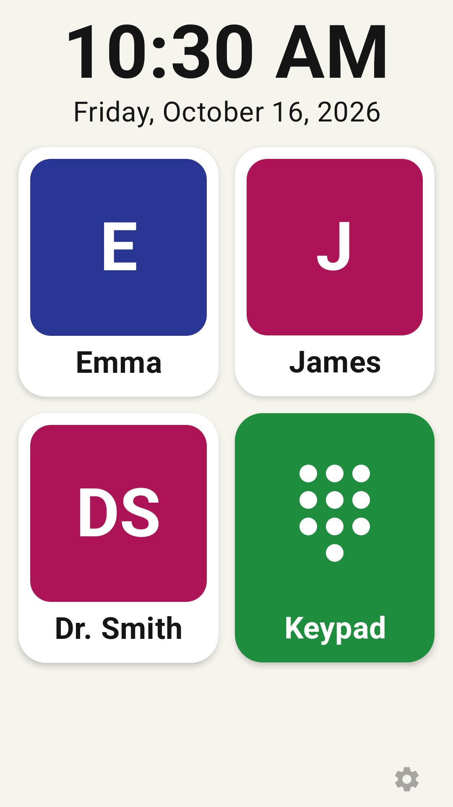
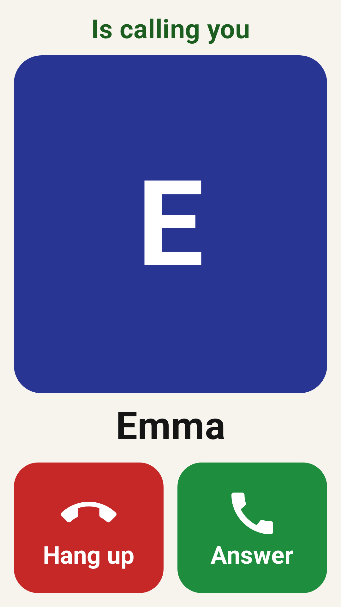
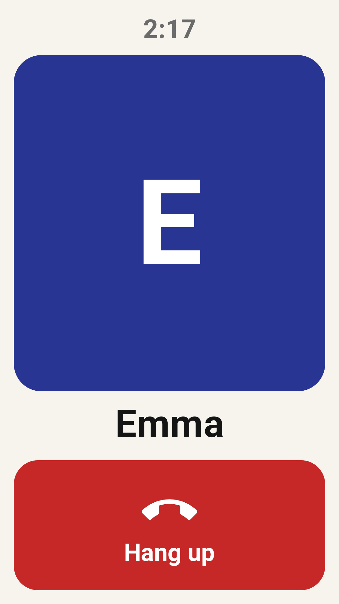
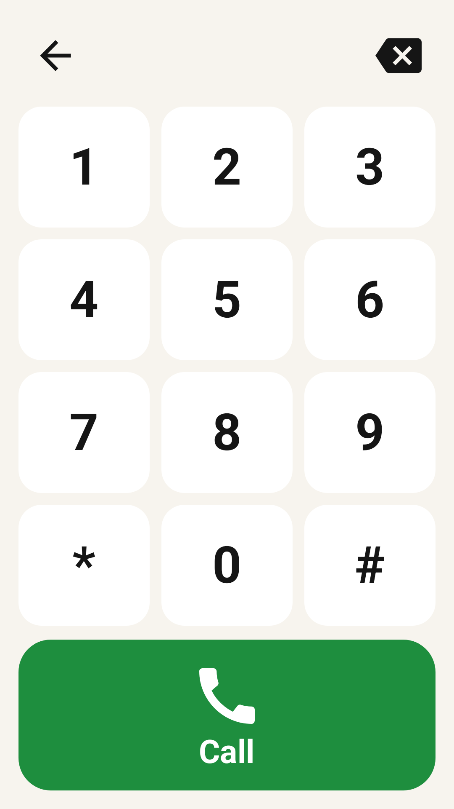
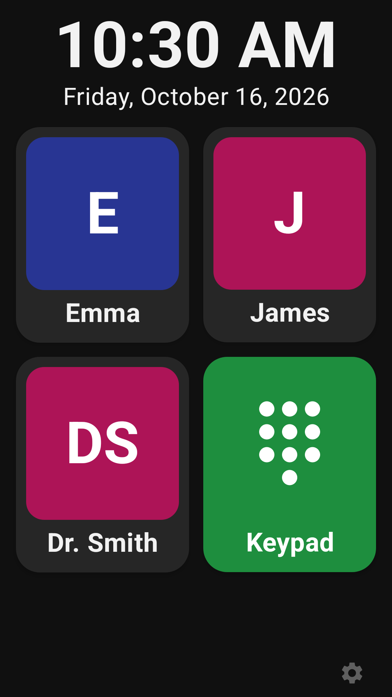

# Simple Phone

[](https://buymeacoffee.com/faxioman)

An Android home screen and phone app for elderly people and people living with dementia.

It replaces both the launcher and the dialer with a single screen that never changes: the time, the date and the photos of loved ones. Tap a photo to call.

<p>





</p>

## Features

- **One screen.** Large clock and date, contact photos and an optional numeric keypad. No icons, menus or other apps to get lost in.
- **One-tap calls**, always on speakerphone. Accidental double taps are ignored.
- **Incoming calls** fill the screen with the caller's photo and two large buttons, *Answer* and *Hang up*. Tapping the photo also answers. Optional auto-answer after a few seconds, for contacts only by default.
- **Busy signal** for a second caller while a call is in progress.
- **Call filtering:** block a list of numbers, or accept only contacts and allowed numbers; block hidden numbers.
- **Contacts** imported from the address book with their photo, or added manually. Photos can be moved and zoomed.
- **Settings for the family** behind a small PIN-protected icon, which returns to the home screen after a few seconds of inactivity. Missed and blocked calls with call back, quick access to messages, screen, theme and language.
- **Screen options:** never sleep, adjustable brightness, ignore the power button. The navigation bar stays hidden.
- Light and dark themes, portrait and landscape.
- 10 languages: English, Italian, Spanish, French, German, Portuguese, Russian, Arabic, Hindi and Chinese.
- No ads and no tracking: contacts, photos and settings stay on the phone.

## Getting started

1. Install the app from Google Play or from the [latest release](https://github.com/faxioman/telefono-semplice/releases/latest).
2. Open the settings (the small gear at the bottom right).
3. Under **Setup**, make the app the default phone app and the home screen, and grant the requested permissions.
4. Add the contacts.
5. Set a PIN.

## Building

Requires JDK 17 and the Android SDK (API 36).

```
./gradlew assembleFullRelease                        # APK
./gradlew bundlePlayRelease                          # Google Play bundle
./gradlew -PscreenshotSdk=35 testFullDebugUnitTest   # tests
```

- **Signing:** release builds are signed with the key given in `SIGNING_KEYSTORE`, `SIGNING_STORE_PASSWORD`, `SIGNING_KEY_ALIAS` and `SIGNING_KEY_PASSWORD`.
- **Translations:** generated by `tools_gen_strings.py`.
- **Store listing:** lives in `app/src/play/play/`.

## Privacy

See the [privacy policy](docs/privacy-policy.html).

---

Made with ❤️ (and a few [coffees](https://buymeacoffee.com/faxioman)) and Claude Opus 5.5 on *medium* effort. Yes, medium: we're saving max for when grandma asks for video calls.
